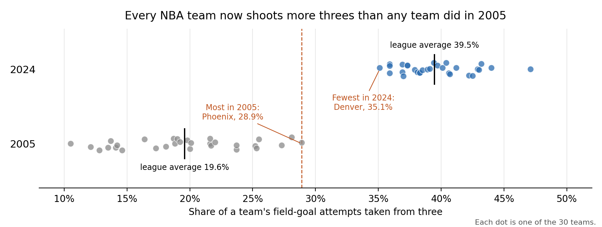
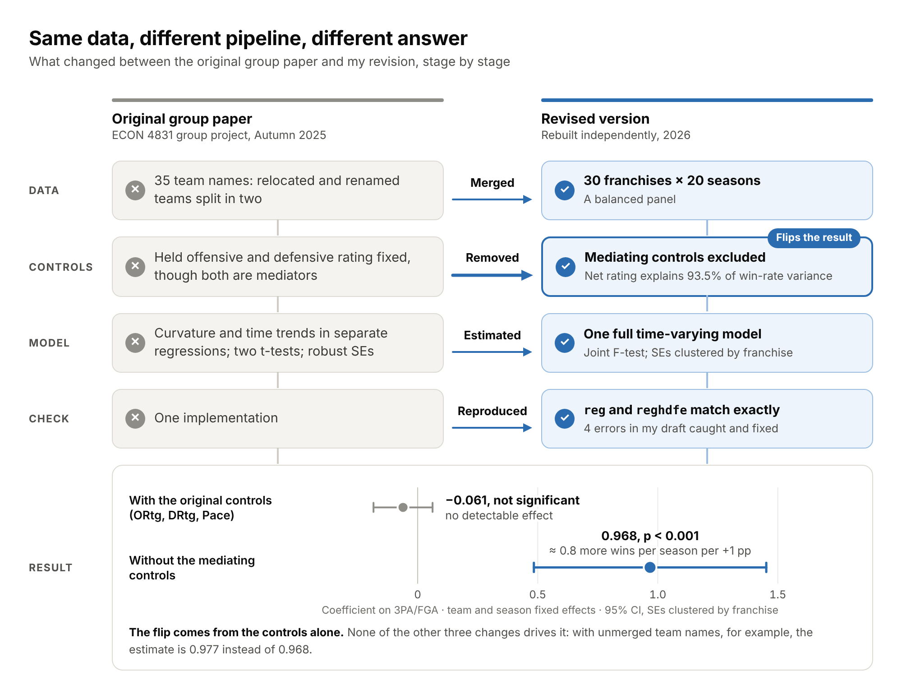
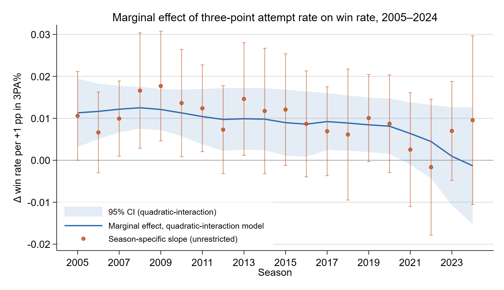

# Should NBA Teams Stop Shooting Threes?

Three-point shooting is a high-risk, high-reward strategy in the NBA: a three goes in less often than a two, but, as the name suggests, it’s worth an extra point. In 2005, about one out of every five shots was a three-pointer; by 2024 that number had doubled. In a competitive league, does a strategy still give you an advantage when everybody adopts it? This research asks:

- Do teams that shoot more three-pointers win more games?
- Has that advantage changed as the whole league adopted it?

This research finds that from 2005 to 2024, teams that shot more threes won more games. Taking one more of every 100 shots from three was associated with 0.8 more wins in an 82-game season. The return was largest in the mid-2000s and seems to have eroded as the rest of the league caught up, but that decline is not statistically significant.

<p align="center">
  
</p>

I use a balanced panel of all 30 NBA franchises over 20 regular seasons (2005–2024, 600 team-seasons) from Basketball-Reference, and regress win rate on three-point attempt rate (3PA/FGA) with team and season fixed effects and standard errors clustered by franchise. 

Team fixed effects absorb time-invariant team characteristics, so the result does not pick up successful teams that happen to shoot more threes; season fixed effects absorb league-wide shocks, such as rule changes and the rise in three-point volume itself. The estimate therefore comes from a franchise’s deviation from both its own long-run three-point rate and its season’s average: it asks whether shooting more threes than other teams is rewarded, not whether the league as a whole has shot more of them. To let the return change over time, I add interactions of 3PA/FGA with linear and quadratic season trends and check the result against an unrestricted model with a separate slope for each season.

The project began as a group project for Autumn 2025 ECON 4831: Sports Data Analytics and Economic Analysis at The Ohio State University. This version ([paper](haotian_nba-three-point-returns-project.pdf)) rebuilds the analysis and reaches a different conclusion. The original version of the project is in [`history/`](history/).

---

## What I did
<p align="center">
  
</p>

### Improved Data Quality

The raw data list 35 team names for 30 franchises, an inconsistency caused by team relocations and renaming. I merged the duplicate identities (SuperSonics/Thunder, New Jersey/Brooklyn Nets, Bobcats/Hornets, Hornets/Pelicans), which yields a balanced panel of 30 franchises × 20 seasons and keeps team fixed effects from splitting one franchise into two.

### Removed Bad Controls

The original model controlled for offensive and defensive rating (ORtg and DRtg: points scored and allowed per 100 possessions) and Pace, and every three-point term came out insignificant. I identified the two ratings as mediators, not confounders: three-point shooting affects winning ***through*** them, and net rating (ORtg − DRtg) alone explains 93.5% of the variance in win rate. Once I removed those controls, the coefficient on 3PA/FGA rose from −0.061 (SE 0.060) to 0.968 (SE 0.237), significant at p < 0.001.

### Estimated the Full Time-Varying Model

The original paper estimated curvature and time variation in separate regressions and planned to test for time variation with two separate t-tests. I estimate them jointly in one model, compute the marginal effect for every season, cluster standard errors by franchise rather than using heteroskedasticity-robust ones, and test time variation with a single joint F-test (F = 1.62, p = 0.215).

### Reproduced Every Estimate Independently

The first version of the code used `reghdfe`. I required a second version that uses only `reg`, the command I learned as an undergraduate, by demeaning each variable within franchise; the two give identical coefficients and standard errors. Reproducing the results this way, and the audit of every reported number that followed, turned up four reporting errors in my revised draft, all now corrected: a miscomputed column in Table 2, a double-rounded within R² in Table 3, VIFs left over from an earlier model, and a mistranscribed standard deviation.

---

## Findings

<p align="center">
    
</p>

- **Three-point shooting is associated with winning.** A one-percentage-point increase in three-point share (3PA/FGA) is associated with a 0.97 percentage point higher win rate, about 0.8 wins over an 82-game season (p < 0.001). The typical deviation the model uses, 3.8 percentage points from a team’s own norm and its season’s average, is worth about 3 wins. The estimate holds without the pandemic seasons (0.99), for 2005–2019 alone (1.02), and with unmerged team names (0.98); it weakens only for 2015–2024 (0.69, p = 0.10).
- **The return was available long before most teams used it.** The edge was largest at the start of the sample, roughly one extra win per percentage point in 2005–2009, when the average team took one in five shots from three. The league did not reach two in five until the 2020s. I read this as slow diffusion rather than a late discovery: recognizing that threes pay is cheap, but rebuilding a roster to shoot them is not.
- **Once everyone adopted three-point shooting, the return seems to erode.** The model’s estimate falls by about a third from its 2008 peak by 2020, reaches roughly zero by 2023–24, and is not significant from 2021 on. Teams also bunched together: relative to the league average, the spread in three-point share fell by more than two-thirds (coefficient of variation 0.26 → 0.07), leaving less room to stand out. But the decline is not statistically significant (F = 1.62, p = 0.215), and the season-by-season slopes show no clear trend (equality of all 20 cannot be rejected, p = 0.514).

| Specification | Coefficient on 3PA% | Std. error |
|---|---|---|
| No fixed effects | 0.249 | (0.103) |
| **Team and season fixed effects** | **0.968** | **(0.237)** |
| Team and season fixed effects + the original model's controls (ORtg, DRtg, Pace) | −0.061 | (0.060) |

*Standard errors clustered by franchise.*

---

## Files

| File | Description |
|---|---|
| `haotian_nba-three-point-returns-project.pdf` | Paper |
| `nba_advanced_stats.csv` | Panel data, 600 team-seasons |
| `nba_3pa_analysis_regression.do` | Replication code for Tables 2–4, the hypothesis tests, the robustness checks, and Figure 1 |
| `figures/` | The three figures in this README: three-point share in 2005 vs. 2024, the before/after comparison, and Figure 1 |
| `history/` | The original group project |

## Reproducing the results

Tested in Stata 17. The only user-written package needed is `estout`:

```stata
ssc install estout
```

Set the working directory to the repository folder and run:

```stata
do nba_3pa_analysis_regression.do
```

The file uses only basic commands (`reg`, `test`, `lincom`, `eststo`, `esttab`, `estpost`). It estimates the fixed-effects models by demeaning each variable within franchise before calling `reg`, which gives exactly the same coefficients and standard errors as dedicated fixed-effects commands such as `reghdfe`. The file ends with a block that prints its key results next to the values reported in the paper.

## Data

Team-level regular-season statistics from [Basketball-Reference](https://www.basketball-reference.com/), cleaned and posted here for replication only.

| Column | Description |
|---|---|
| `Team` | Team name as recorded (35 values) |
| `Franchise`, `FranchiseID` | Consolidated franchise (30 values) |
| `Season`, `YearIndex` | Season, labeled by the year it ends; counter from 1 (2005) to 20 (2024) |
| `WinRate` | Games won divided by games played |
| `3PA%` | Three-point attempts divided by field-goal attempts |
| `ORtg`, `DRtg` | Points scored and allowed per 100 possessions |
| `Pace` | Possessions per 48 minutes |

All variables are rates, so the shortened 2012, 2020, and 2021 seasons are comparable to full 82-game seasons.

---

## Open questions

**Would ORtg<sub>t−1</sub>, DRtg<sub>t−1</sub> be valid controls?** Offensive and defensive ratings from season *t* − 1 are determined before this season’s shot choices, so they are not post-treatment in the same way. But three-point strategy is persistent: last season’s ratings partly reflect last season’s three-point share, so controlling for them may still absorb part of the effect. On the other hand, they may capture time-varying team quality that the fixed effects miss, such as a multi-year window in which a team contends. I have not yet worked out which effect dominates.

**Why did the rest of the league take so long to catch up?** The edge was largest at the start of the sample, yet the league-average three-point share did not double (0.196 → 0.395) until the 2020s. This looks like a technology-diffusion problem, and the natural next step is to study adoption directly: which teams moved early, and whether roster turnover or coaching changes predicted how fast they moved.

---

## How I used AI

**What I decided.** I designed the rule of how to merge 35 team names into 30 franchises, and I identified ORtg and DRtg as mediators and asked for the model to be re-estimated without them. When the first version of the code used `reghdfe`, I required a second version using only `reg`, the method I understand best, and I asked why problems had not been caught earlier, which led to an audit of every reported number.

**What Claude did.** Claude wrote and debugged the Stata code for both versions, carried out the team-name merge, produced Figure 1, ran the audit that found the four reporting errors, and drafted the Results and Conclusion sections of the paper and reference wording for parts of this README.

**How I verified it.** I ran all the code in Stata myself and checked every output against the paper. The two independent versions give identical coefficients and standard errors, and the do-file ends with a block that prints its key results next to the paper’s values. I revised all drafted text in my own words.

---

## Author

Haotian Chang, MA student in Computational Social Science (Economics), University of Chicago.
